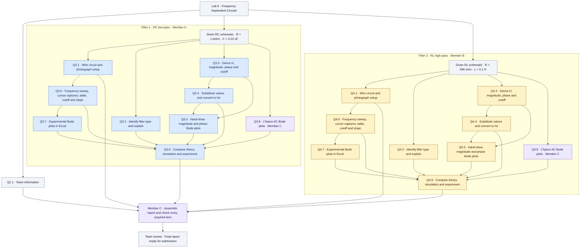

# ENGR 202 Lab 6 English Edition

Characterizing Frequency Dependent Circuits. This repository contains English question guides, dependency trees, and a three-person work plan based on the instructor's Week 7 Lab 6 document. This is experiment preparation; measured data, experimental photographs, and a final report are pending.

- [Three-person work plan](TEAM_PLAN.md)
- [All 19 dependency trees PDF](analysis/Lab6_Dependency_Trees.pdf)
- [LaTeX source](analysis/latex/Lab6_Dependency_Trees.tex)
- [Original instructor document](source/Lab6_Instructions.docx)
- [Measurement and submission guide](MEASUREMENT_GUIDE.md)

## Complete question dependency graph

This is one connected graph covering **all 19 numbered questions**, matching the question-to-question planning format used for Lab 5. Follow the arrows from prerequisites to dependent answers; multiple incoming arrows indicate results that must converge.

**Colors represent proposed responsibility:** blue = Member A (RC), amber = Member B (RL), purple = Member C (simulations and integration), gray = shared inputs or team review. Colors do not indicate completion. All experimental results remain pending.

### Parallel work and convergence

- Q1.1 and both filter workflows can start independently. Within each filter, setup, classification, analytical derivation, and ideal LTspice simulation can start from the given schematic. Simulation does not need to wait for measured data.
- Q3.4/Q4.4 use the corresponding derivation. Q3.5/Q4.5 use the analytical magnitude and phase and the numerical cutoff frequency.
- Q3.6/Q4.6 require a verified physical circuit. Q3.7/Q4.7 require measured data, including signed phase. Setup photographs remain mandatory even though taking a photograph is not a prerequisite for acquiring data.
- Q3.9/Q4.9 combine classification, theoretical results, hand sketches, the measured table and plots, and LTspice results. Include actual measured cutoff and stopband slope when comparing trends.
- With one ADALM2000, schedule RC and RL measurements sequentially while calculations and simulations overlap. The two filter workflows are independent; their vertical placement is only for readability.
- All 19 questions reach final review directly or through their downstream results. The final review also checks both setup photographs and every required appendix capture.

[Standalone graph source](planning/whole-lab.mmd) · [Three-person work plan](TEAM_PLAN.md)

The individual formula diagrams linked below are additional aids. The connected graph above shows the dependencies between questions across the whole lab.

## Circuits and channels

| Filter | Original component values | Output location | Ideal type | Ideal cutoff |
| --- | --- | --- | --- | --- |
| RC | R = 1000 ohm, C = 0.22 uF | Across capacitor | Low-pass | 723.43 Hz |
| RL | R = 690 ohm, L = 0.1 H | Across inductor | High-pass | 1098.17 Hz |

CH1 = Vin and CH2 = Vout. Use a 2 Vpp sine wave, start setup at 1 kHz, and measure from 10 Hz to 20 kHz. Use the Lab 6 channel mapping and the component values above.

## Question guides

- [Q1.1 Group information](questions/Q1_1.md)
- [Q3.1 RC Setup photograph](questions/Q3_1.md)
- [Q3.2 RC Filter classification](questions/Q3_2.md)
- [Q3.3 RC Transfer function derivation](questions/Q3_3.md)
- [Q3.4 RC Numerical expressions in Hz](questions/Q3_4.md)
- [Q3.5 RC Hand-drawn Bode plots](questions/Q3_5.md)
- [Q3.6 RC Measured frequency sweep](questions/Q3_6.md)
- [Q3.7 RC Experimental Bode plots in Excel](questions/Q3_7.md)
- [Q3.8 RC LTspice AC simulation](questions/Q3_8.md)
- [Q3.9 RC Theory simulation and measurement comparison](questions/Q3_9.md)
- [Q4.1 RL Setup photograph](questions/Q4_1.md)
- [Q4.2 RL Filter classification](questions/Q4_2.md)
- [Q4.3 RL Transfer function derivation](questions/Q4_3.md)
- [Q4.4 RL Numerical expressions in Hz](questions/Q4_4.md)
- [Q4.5 RL Hand-drawn Bode plots](questions/Q4_5.md)
- [Q4.6 RL Measured frequency sweep](questions/Q4_6.md)
- [Q4.7 RL Experimental Bode plots in Excel](questions/Q4_7.md)
- [Q4.8 RL LTspice AC simulation](questions/Q4_8.md)
- [Q4.9 RL Theory simulation and measurement comparison](questions/Q4_9.md)

## Work sequence

For each filter, wiring, theory, and ideal simulation can start in parallel. Complete the measured table and cursor captures before building experimental Excel plots and writing the final comparison. Q3.9 and Q4.9 depend on the corresponding theoretical, simulated, and experimental evidence.

## Rebuilding

Run `xelatex Lab6_Dependency_Trees.tex` inside `analysis/latex` in a complete TeX installation with TikZ. The PDF and PNG previews use Computer Modern mathematical rendering. The accompanying TikZ source can also be compiled independently.

The separate [original Lab6 repository](https://github.com/OutisNemosseus/Lab6) is retained.
