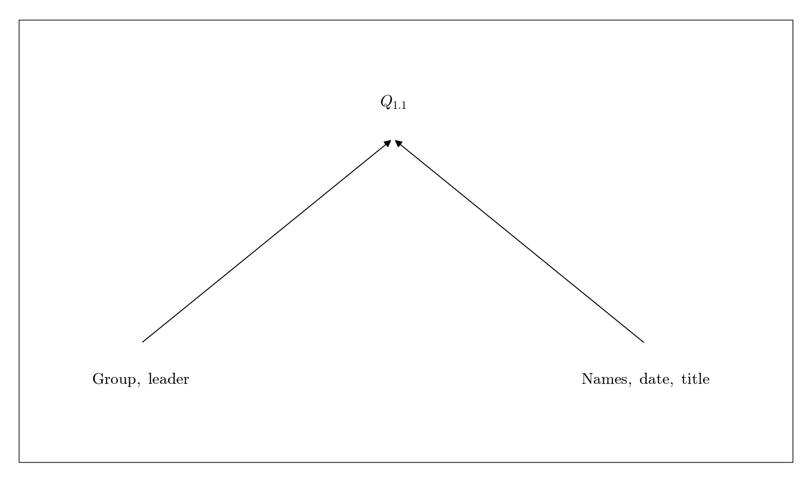

# Q1.1 Group information

All three members confirm the group number, leader, member names, and experiment date.

## Deliverables

Enter the group number, leader, all member names, date, and full lab title. Leave unknown information pending confirmation.

Status: pending experiment / completion. This dependency tree is a work plan, not a completed experimental answer.
