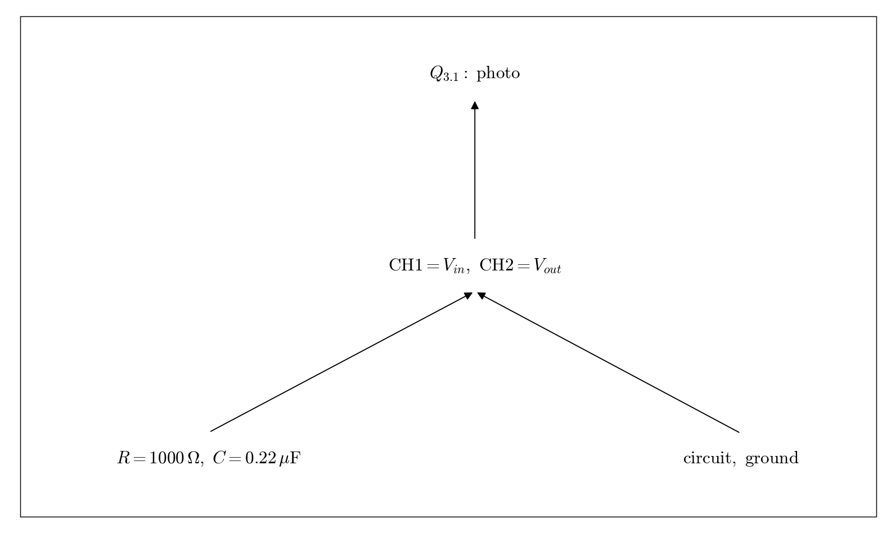

# Q3.1 RC Setup photograph

Wire the circuit shown in the instructions. Connect CH1 to Vin and CH2 to Vout; verify the common ground.

## Deliverables

Provide an actual breadboard photograph showing components, input, output, and ground connections. An oscilloscope screenshot does not replace this photograph.

Status: pending experiment / completion. This dependency tree is a work plan, not a completed experimental answer.
