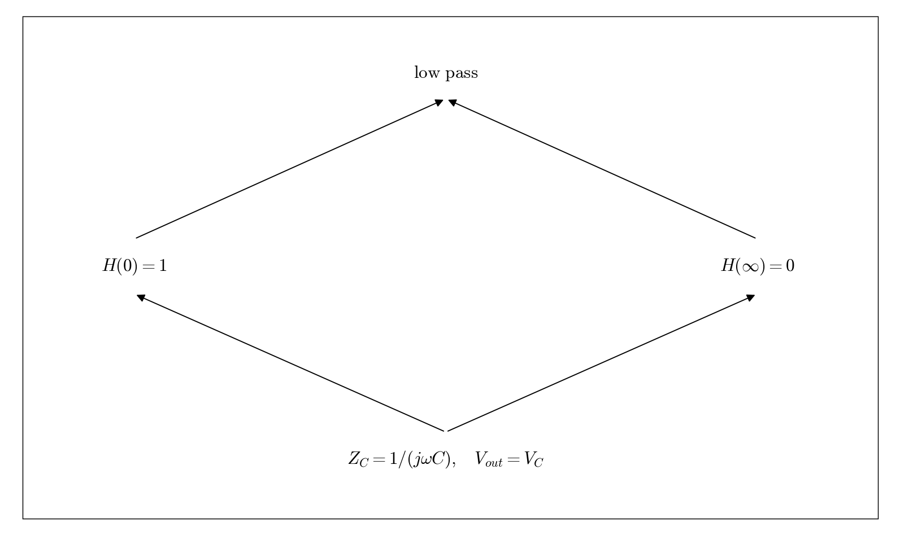

# Q3.2 RC Filter classification

Locate the output element, then evaluate the low-frequency and high-frequency limits.

## Deliverables

Low-pass: at low frequency the capacitor approaches an open circuit and Vout approaches Vin; at high frequency it approaches a short circuit and Vout approaches zero.

Status: pending experiment / completion. This dependency tree is a work plan, not a completed experimental answer.
