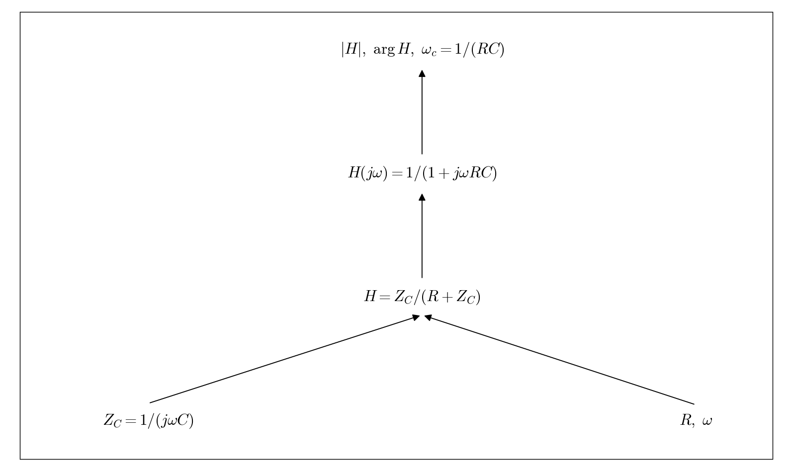

# Q3.3 RC Transfer function derivation

Start with the series voltage divider. Derive H, the cutoff angular frequency, the magnitude, and the phase.

## Deliverables

Show the voltage divider, algebraic simplification, |H|, arg H, and omega_c.

Status: pending experiment / completion. This dependency tree is a work plan, not a completed experimental answer.
