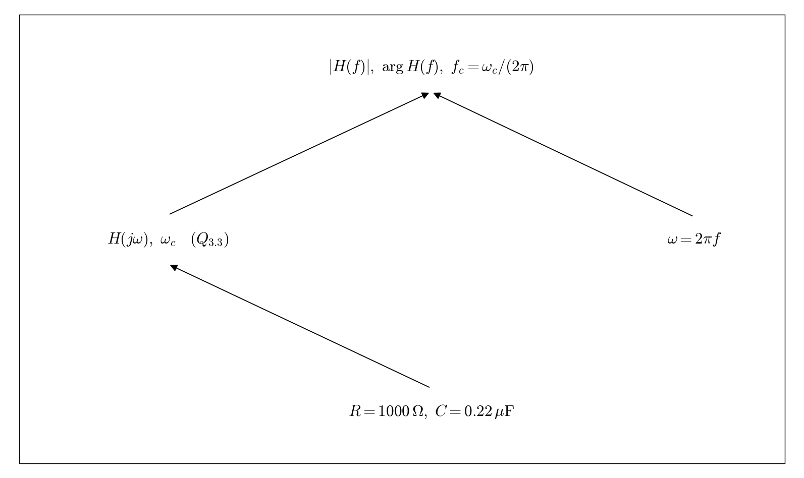

# Q3.4 RC Numerical expressions in Hz

Use Q3.3 and the component values in the original schematic. Substitute omega = 2 pi f.

## Deliverables

Provide numerical expressions for magnitude and phase, and the ideal cutoff frequency: 723.43 Hz.

Status: pending experiment / completion. This dependency tree is a work plan, not a completed experimental answer.
