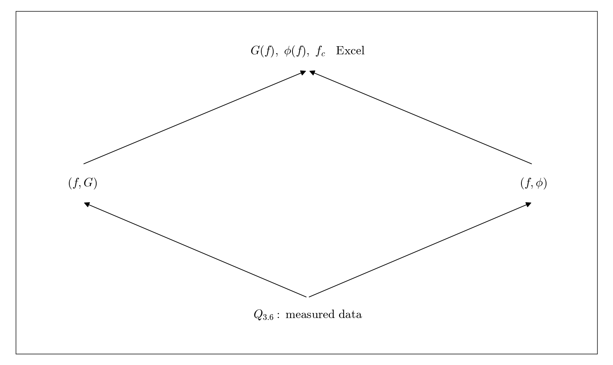

# Q3.7 RC Experimental Bode plots in Excel

Complete the measured data in Q3.6 first. Use experimental values for these plots.

## Deliverables

Use Excel to create gain in dB and phase in degrees versus frequency. Use a logarithmic numeric frequency axis and label the measured cutoff.

Status: pending experiment / completion. This dependency tree is a work plan, not a completed experimental answer.
