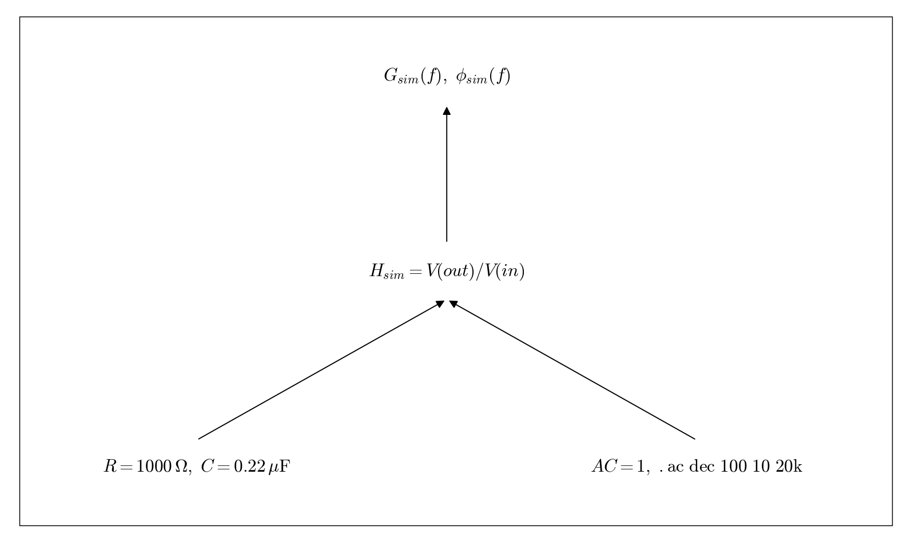

# Q3.8 RC LTspice AC simulation

Build a separate simulation from the original schematic. This can proceed in parallel with measurements; verify matching component values.

## Deliverables

Use a source with AC amplitude 1 and .ac dec 100 10 20k. Display dB(V(out)/V(in)) and the phase of V(out)/V(in). Save the circuit, settings, and result captures.

Status: pending experiment / completion. This dependency tree is a work plan, not a completed experimental answer.
