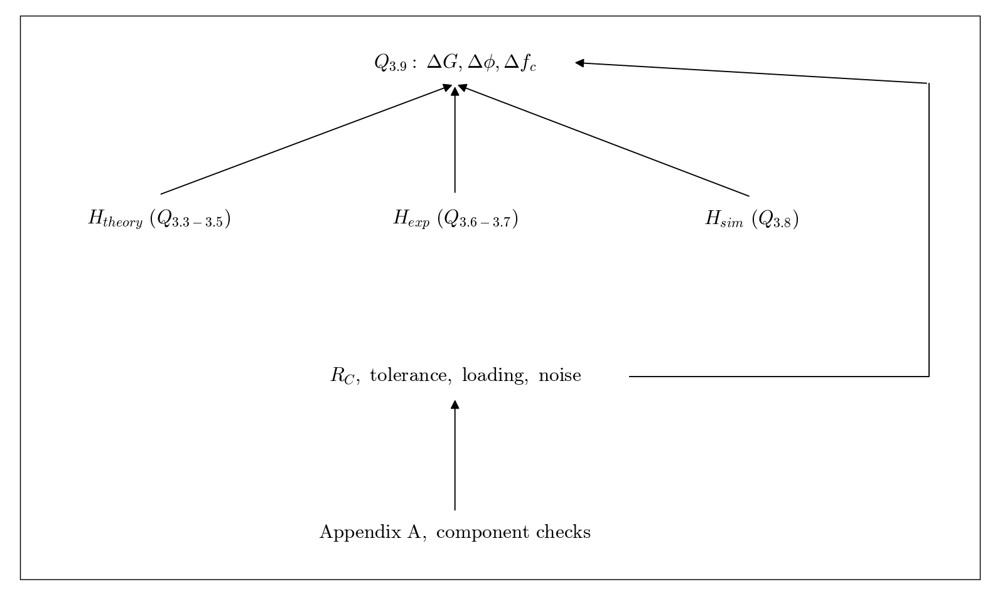

# Q3.9 RC Theory simulation and measurement comparison

Combine Q3.3 through Q3.8. Compare magnitude, phase, cutoff frequency, and stopband trends.

## Deliverables

Compare all three results and explain differences. The instructions explicitly require theoretical and measured magnitude curves on the same Excel chart. Also check phase. Treat proposed nonideal effects as hypotheses supported by evidence.

Status: pending experiment / completion. This dependency tree is a work plan, not a completed experimental answer.
