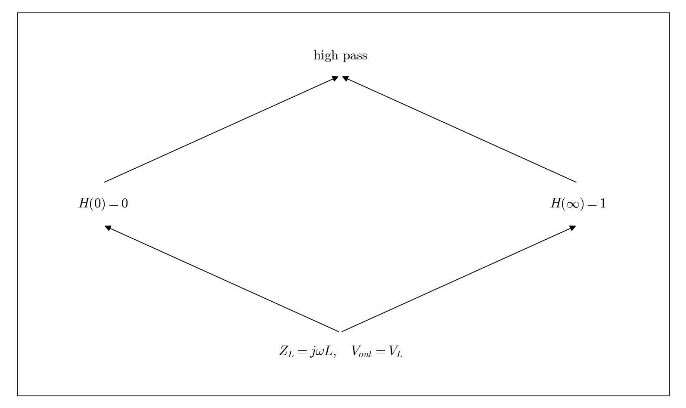

# Q4.2 RL Filter classification

Locate the output element, then evaluate the low-frequency and high-frequency limits.

## Deliverables

High-pass: at low frequency the inductor approaches a short circuit and Vout approaches zero; at high frequency its impedance increases and Vout approaches Vin.

Status: pending experiment / completion. This dependency tree is a work plan, not a completed experimental answer.
