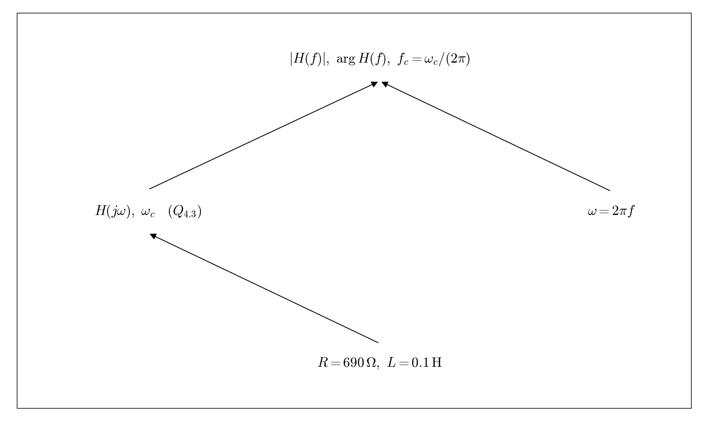

# Q4.4 RL Numerical expressions in Hz

Use Q4.3 and the component values in the original schematic. Substitute omega = 2 pi f.

## Deliverables

Provide numerical expressions for magnitude and phase, and the ideal cutoff frequency: 1098.17 Hz. The question should refer to R and L.

Status: pending experiment / completion. This dependency tree is a work plan, not a completed experimental answer.
