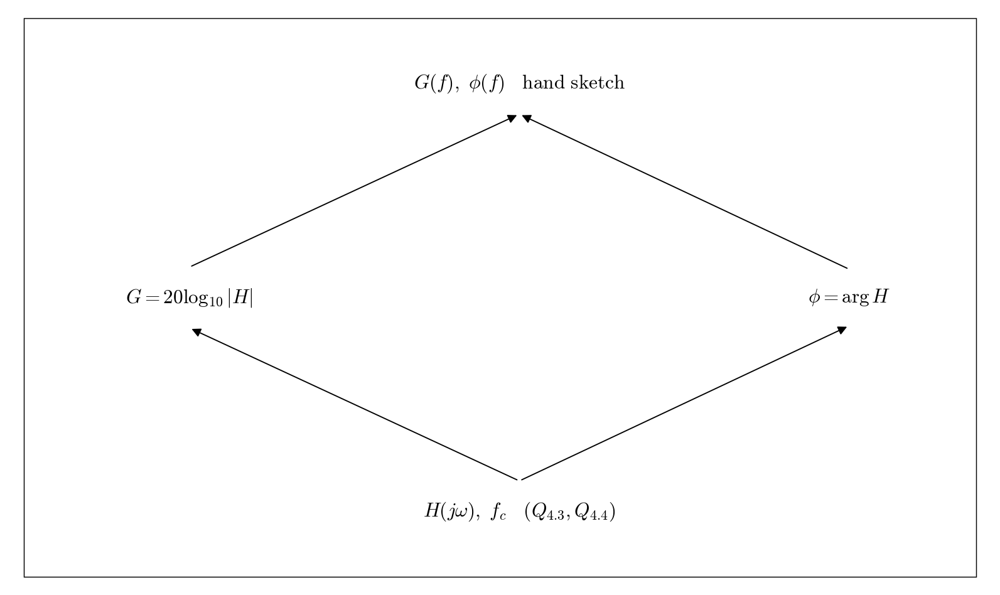

# Q4.5 RL Hand-drawn Bode plots

Use Q4.3 and the cutoff frequency from Q4.4 to label the frequency axis in Hz.

## Deliverables

Draw magnitude and phase by hand. Label fc, -3.01 dB, the cutoff phase, and asymptotes. Include your own hand-drawn work.

Status: pending experiment / completion. This dependency tree is a work plan, not a completed experimental answer.
