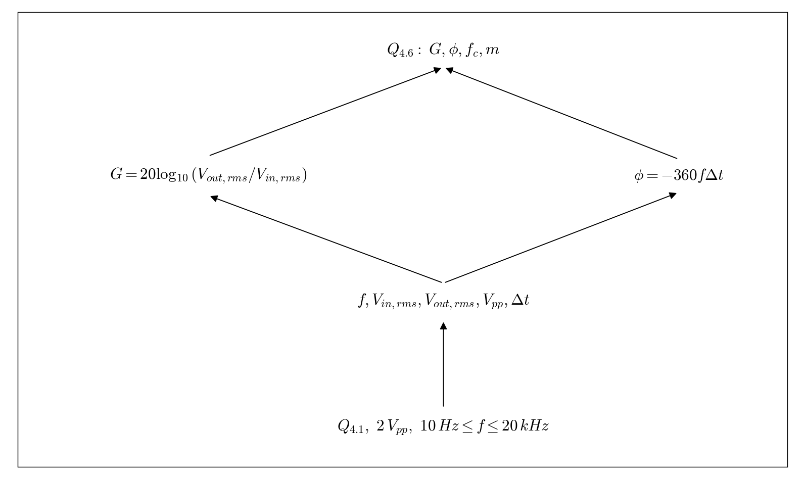

# Q4.6 RL Measured frequency sweep

Complete the setup in Q4.1. Start with a 2 Vpp, 1 kHz sine wave, then measure all 11 required frequencies. Add points near cutoff.

## Deliverables

For every point, record actual frequency, Vin/Vout in VRMS and Vpp, cursor time difference, phase, and gain. Save a full-screen capture with measurements and cursors visible. Report the measured half-power frequency and stopband slope. Place RL captures in Appendix C; Q4.6 says Appendix B, which conflicts with the final appendix heading.

Status: pending experiment / completion. This dependency tree is a work plan, not a completed experimental answer.
