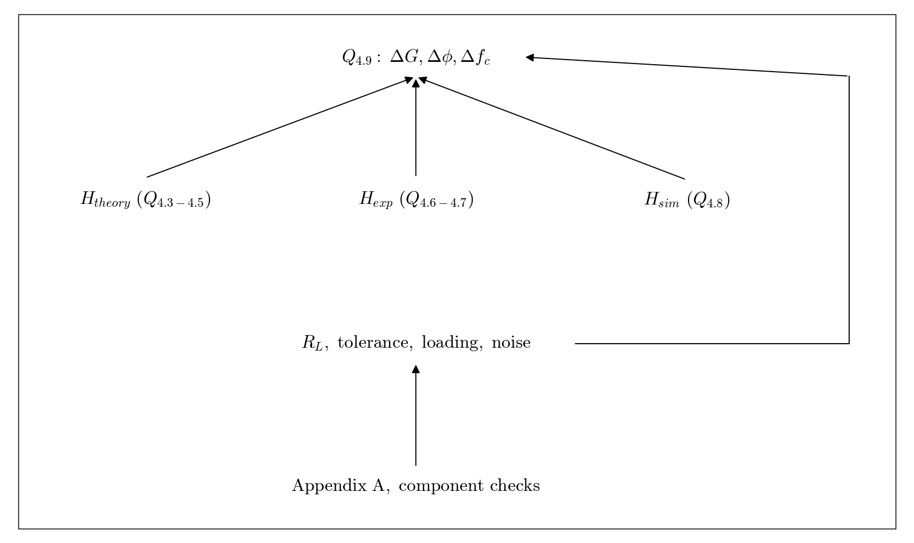

# Q4.9 RL Theory simulation and measurement comparison

Combine Q4.3 through Q4.8. Compare magnitude, phase, cutoff frequency, and stopband trends.

## Deliverables

Compare all three results and explain differences. Compare the three Bode plots. An Excel overlay is recommended for clarity. Treat proposed nonideal effects as hypotheses supported by evidence.

Status: pending experiment / completion. This dependency tree is a work plan, not a completed experimental answer.
